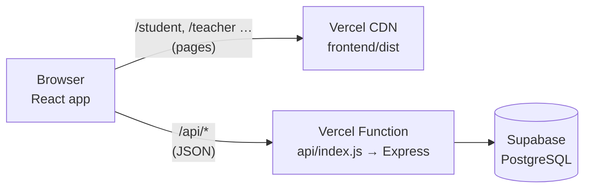
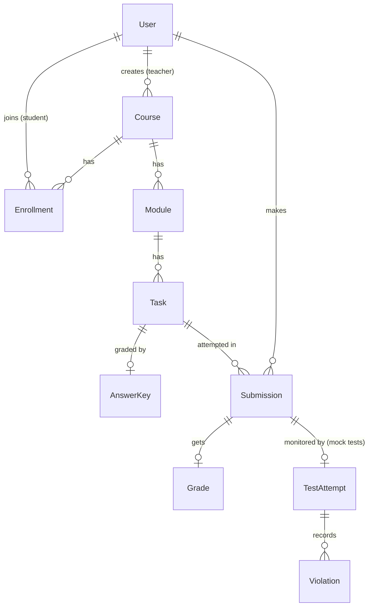
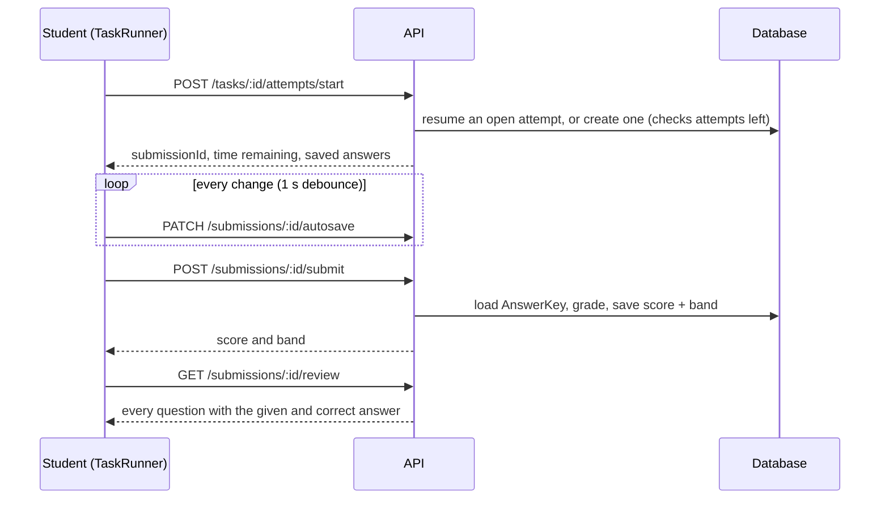
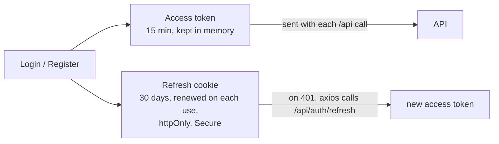
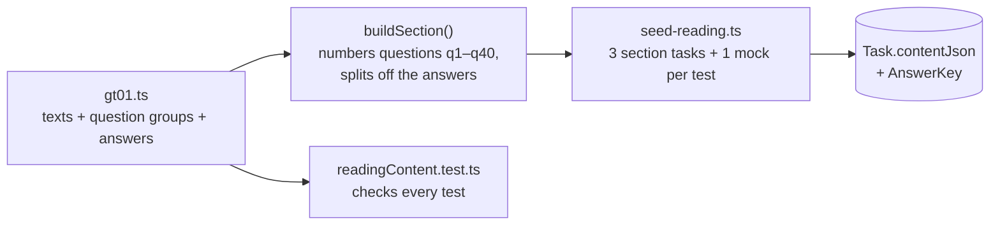

# Project Structure and Approach

This explains how the IELTS Prep Platform is put together and why it is built that way. For running it, see [GUIDE.md](GUIDE.md); for putting it online, see [DEPLOY.md](DEPLOY.md).

---

## 1. The big picture

It is one repository with two apps, deployed together as one site:



| Part | Tech | Job |
|---|---|---|
| **Frontend** (`frontend/`) | React 19, Vite, React Router, Zustand, axios | Pages for students and teachers, the test screen, the review page |
| **Backend** (`backend/`) | Express 4, TypeScript, Prisma, Zod, JWT | Logins, courses, starting and saving tests, grading, reviews |
| **Database** | PostgreSQL: Supabase online, embedded Postgres locally | Users, courses, tasks, answer keys, submissions, grades |
| **Glue** (`api/`, `vercel.json`) | Vercel | Serves the React build and runs Express as one function on the same address |

Because the website and the API share one address, there is no cross-site setup (CORS) in production, and the login cookie just works.

---

## 2. Folder map

```
ielts-prep-platform/
├── api/index.js              Vercel entry: hands every /api/* request to Express
│                             (frontend/public has the PWA files: manifest, sw.js, icons)
├── vercel.json               build, output folder, routing rules
├── package.json              root scripts: build, dev, deploy:setup, deploy:check
├── Dockerfile                alternative: the whole app as one container
├── deploy.env                your production settings (gitignored, never committed)
├── docs/                     GUIDE, DEPLOY, ARCHITECTURE (this file)
│
├── backend/
│   ├── src/
│   │   ├── app.ts            builds the Express app (routes, static files, errors)
│   │   ├── index.ts          starts a long-running server (local dev, Docker)
│   │   ├── config/env.ts     reads and checks environment variables
│   │   ├── prisma.ts         the shared database client
│   │   ├── middleware/       requireAuth, requireRole, error handler
│   │   ├── routes/           one file per area: auth, courses, modules, tasks,
│   │   │                     submissions, attempts
│   │   ├── services/
│   │   │   ├── auth.service.ts          passwords (bcryptjs) and tokens (JWT)
│   │   │   └── grading/                 answer matching and band tables
│   │   └── types/enums.ts    allowed values for roles, module types, statuses
│   │
│   ├── prisma/
│   │   ├── schema.prisma     the database tables
│   │   ├── migrations/       SQL history, applied in order
│   │   ├── reading/
│   │   │   ├── types.ts      how a reading test is described, plus buildSection()
│   │   │   ├── general/      General Training tests (gt01–gt03), the course default
│   │   │   └── tests/        Academic tests (test01–test03), kept for later use
│   │   ├── seed.ts           demo accounts for local development only
│   │   ├── seed-reading.ts   loads the reading tests into a course
│   │   ├── create-teacher.ts makes or resets a teacher account
│   │   └── review-reading.ts prints a submission question by question
│   │
│   ├── scripts/              local Postgres, deploy:setup, deploy:check
│   └── tests/                grading, reading content, API (Vitest + Supertest)
│
└── frontend/
    └── src/
        ├── App.tsx           all page routes and who may see them
        ├── api/              one small file per backend area; client.ts adds tokens
        ├── stores/           authStore (who is logged in), testSessionStore (lockdown)
        ├── routes/           pages: auth/, student/, teacher/, results/
        ├── components/
        │   ├── tasks/TaskRunner.tsx      the test screen
        │   └── lockdown/                 fullscreen and tab-switch monitoring
        ├── lib/              question helpers, IndexedDB answer backup
        └── types/domain.ts   shapes shared by the pages
```

---

## 3. The data model



| Table | What it holds |
|---|---|
| **Course → Module → Task** | "IELTS Preparation" → "General Training Reading — Practice Test 1" → "T1 Section 1" |
| **Task.contentJson** | The texts and questions shown to students, with no answers. Also `bandScale` and `sectionLabel`. |
| **AnswerKey** | The correct answers, kept in a separate table so they are never sent to the browser |
| **Submission** | One attempt: the answers given (`responseJson`), status, score |
| **Grade** | The band, and whether it was graded automatically or set by a teacher |
| **TestAttempt / Violation** | Mock-test monitoring: when it started and ended, and each fullscreen exit or tab switch |

Task content is stored as JSON rather than as many small tables. A reading test has nested parts (sections, question groups, options, figures), and JSON keeps it flexible: a new question type needs no database change.

---

## 4. How a test works, end to end



Key rules:

- **The server keeps time.** The timer counts down from when the attempt started on the server. If time ran out while the student was away, the next start submits the saved answers and returns 409 with the submission ID.
- **Answers are saved twice:** to the server (debounced, and flushed when leaving the page) and to the browser's IndexedDB as a backup.
- **Grading** ignores case and spacing (`" Cell  Wall "` = `"cell wall"`) and allows several accepted answers per question.
- **Bands:** a single-section task is scaled to 40 questions, then looked up in the task's band table (`GENERAL_TRAINING` or `ACADEMIC`).
- **Mock tests (lockdown):** the browser watches for fullscreen exits, tab switches, copy/paste and devtools. Each one is sent to the server, and the second one submits the test automatically. The server rejects violations once an attempt has ended.

---

## 5. Logins and permissions



- **Two roles:** `STUDENT` and `TEACHER_ADMIN`. Public sign-up always creates a student; teachers are created with `create-teacher`, never through the website.
- **Sliding session:** each refresh issues a new 30-day cookie and returns the user's profile. A new tab or the installed app can therefore restore the session from the cookie alone.
- **Students** see only courses they joined (with a Course ID) and only their own submissions.
- **Teachers** see only the courses they created, and their students' submissions in those courses.
- **Access checks happen on the server** in every route. The frontend hides links for a nicer experience, but it is never trusted for access.

---

## 6. Installable app (PWA)

- **`frontend/public/manifest.webmanifest`** sets the name, icons and standalone window. The app starts at `/`, which goes to the dashboard when signed in.
- **`frontend/public/sw.js`** is the service worker:
  - pages are network first, falling back to the cached app shell offline;
  - hashed `/assets/*` files are cache first;
  - `/api/*` is never cached.
  - Bump `VERSION` in it to clear old caches.
- **`frontend/src/pwa.ts`** registers the worker (production builds only) and keeps the browser's install prompt for the **Install app** button (`components/pwa/InstallAppButton.tsx`).
- **Carrying the session into the app:** on Android and desktop, the installed app shares the browser's cookies, so the refresh cookie signs it in. iOS isolates home-screen apps from Safari, so users sign in once inside the app.

## 7. How the reading content is built

Tests are written as TypeScript files, not typed into an admin screen. That means they're reviewed like code, versioned in git, and checked by automated tests.



Each test file lists three sections. Each section has its text and its question groups, and each group has its type, instruction, options and answers. `buildSection()` turns this into numbered questions, so Section 2's questions continue from where Section 1 ended, as on the real paper.

**Safety checks** in `readingContent.test.ts` run on every test:
- exactly 40 questions, numbered in order;
- every choice answer is one of the options;
- written answers fit the word limit and actually appear in the text;
- the total length is within the real exam range;
- General Training tests follow the 3-section layout.

**To add a test:** copy `general/gt03.ts` to `gt04.ts`, write new texts and questions, add it to `general/index.ts`, run `npm test`, then `npm run deploy:setup`.

---

## 8. Environments

| | Local development | Automated tests | Production |
|---|---|---|---|
| Database | embedded Postgres, port 5433 (`npm run db:local`) | a fresh throwaway Postgres on every run | Supabase |
| Server | `tsx watch` on port 4000 + Vite on 5173 | Supertest, no server | Vercel Function + CDN |
| Settings | `backend/.env` | set by `vitest.config.ts` | Vercel env vars, plus `deploy.env` for scripts |
| Accounts | demo `password123` accounts (`npm run seed`) | created per test | real teacher via `create-teacher` |

Production database migrations run during Vercel's build, on production deploys only, so preview deploys can't change the live schema.

---

## 9. The approach, in short

1. **Keep it in one repo, one deploy and one address.** That gives fewer moving parts, no CORS, a simple cookie login and one place to look when something breaks.
2. **The server is the source of truth.** Time limits, attempt limits, grading, permissions and answer keys are all decided on the server. The browser only displays and collects.
3. **Never lose a student's answers.** The app autosaves on every change, flushes when leaving the page, keeps an IndexedDB backup, and resumes the attempt instead of using up a new one.
4. **Content is code.** Tests are typed and version-controlled, and checked automatically before they reach students. All texts are original, to avoid copyright problems with real IELTS material.
5. **Follow the real exam closely.** It uses official numbering, the official question types and instruction wording, separate band tables for General Training and Academic, and a timed, monitored mock.
6. **Be safe by default in production.** Sign-up creates students only, the cookie is Secure, there are no demo accounts, secrets live only in Vercel and `deploy.env`, and `deploy:check` verifies all of this.
7. **Test at every level:** unit tests (grading), content tests (every reading test), API tests (real routes against real Postgres), plus `deploy:check` against the live site.

---

## 10. Where to make common changes

| I want to… | Change |
|---|---|
| Add or edit a reading test | `backend/prisma/reading/general/` → `npm test` → `npm run deploy:setup` |
| Change how answers are marked | `backend/src/services/grading/objectiveGrading.service.ts` |
| Change band scores | `backend/src/services/grading/bandConversion.ts` |
| Add an API endpoint | a file in `backend/src/routes/`, mounted in `app.ts` |
| Change the test screen | `frontend/src/components/tasks/TaskRunner.tsx` |
| Change the review page | `frontend/src/routes/results/Review.tsx` and `GET /submissions/:id/review` |
| Add a page | `frontend/src/routes/…`, registered in `App.tsx` |
| Change the database | `schema.prisma` → `npx prisma migrate dev --name …`, then push (Vercel applies it) |

---

## 11. Not built yet

- **Listening, Writing and Speaking** exist as module types, but there's no content for them. Writing and Speaking have no automatic grading; a teacher can set a band by hand (`PUT /submissions/:id/grade`). The Anthropic API settings in `env.ts` are placeholders for future AI marking and aren't used yet.
- **No password reset or email.** A teacher password is reset with `npm run deploy:setup`.
- **Single-section bands are estimates**, because a section score is scaled up to 40 questions.
