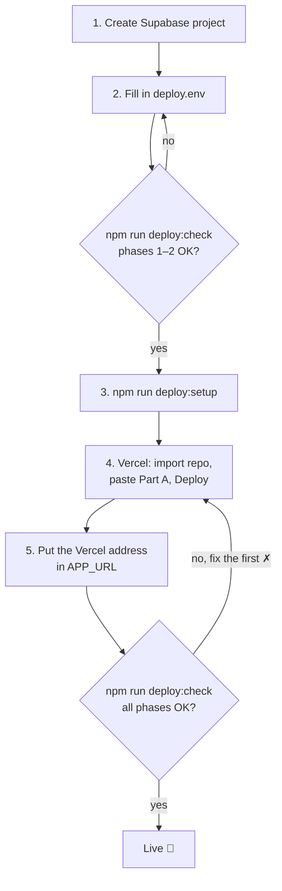

# Deploying to Vercel + Supabase

Everything runs from one file, `deploy.env` in the repo root, and two commands:

| Command | What it does |
|---|---|
| `npm run deploy:setup` | Prepares the Supabase database: creates the tables, your teacher account and the reading tests. Safe to run again. |
| `npm run deploy:check` | Tests everything in 3 phases and tells you exactly what to fix |

`deploy.env` holds your passwords. It is gitignored, so it never goes to GitHub. Don't paste it into chat either.



---

## 1. Create the Supabase project

1. Go to **supabase.com** → **New project**.
2. Set a **database password**. Use only letters and digits, so it doesn't need escaping in the address.
3. Pick the region **East US (North Virginia)**. It's closest to Vercel's default servers.
4. Wait about 2 minutes for the project to start.

## 2. Fill in `deploy.env`

Open `deploy.env` in the repo root. The two JWT secrets and `TEACHER_PASSWORD` are already filled in with random values.

| Line | Where to get it |
|---|---|
| `DATABASE_URL` | Supabase → **Connect** → **Transaction pooler** (port **6543**). Keep `?pgbouncer=true&connection_limit=1` at the end. |
| `DIRECT_URL` | Supabase → **Connect** → **Session pooler** (port **5432**) |
| `TEACHER_EMAIL` | The email you'll log in with as teacher |
| `TEACHER_PASSWORD` | Already generated. Change it if you prefer your own (12+ characters). |
| `APP_URL` | Leave as is for now; you fill it in at step 5 |

In both database addresses, replace `[YOUR-PASSWORD]` with your database password.

Then test:

```bash
npm run deploy:check
```

Phases 1 and 2 should pass, apart from **"tables have not been created yet"**, which is expected at this point. Phase 3 is skipped until `APP_URL` is set.

## 3. Prepare the database

```bash
npm run deploy:setup
```

It should end with `Test 1: added`, `Test 2: added`, `Test 3: added` and `✓ Setup done`. Run `npm run deploy:check` again: phase 2 should now be all ✓, and it prints your **Course ID**.

## 4. Deploy on Vercel

1. **vercel.com** → **Add New → Project** → import **English_practices**.
2. Leave **Root Directory** empty and set **Framework Preset** to **Other**.
3. Open **Environment Variables** and paste **only Part A** of `deploy.env`: the 4 lines `DATABASE_URL`, `DIRECT_URL`, `JWT_ACCESS_SECRET` and `JWT_REFRESH_SECRET`. Vercel's form accepts pasted `.env` lines and splits them into variables.
4. Click **Deploy**. It takes about 2 minutes.

Don't add Part B (`TEACHER_*`, `APP_URL`) to Vercel. Those values are only for the scripts on your computer.

## 5. Test the live site

Copy the production address Vercel shows (for example `https://english-practices.vercel.app`) into `APP_URL` in `deploy.env`, then:

```bash
npm run deploy:check
```

Phase 3 takes a real test on the live site with a temporary student account, then deletes that account. It checks that:

- the website and deep links load;
- the API is running, and logins and wrong passwords behave correctly;
- the login cookie is secure, and you stay signed in after a reload;
- Vercel has the same secrets as `deploy.env`;
- a student can sign up, enrol, start a test, autosave, resume, submit (all answers correct → band 9) and see the review;
- the teacher can see that review.

When it says **✓ All checks passed**, open the site, log in as the teacher and share the **Course ID** with students.

---

## When a check fails

Fix the **first** ✗; later ones often follow from it. Each ✗ comes with a `→` hint.

| You see | Fix |
|---|---|
| `… is not filled in` | Replace the `<...>` part in `deploy.env` |
| `DIRECT_URL uses the session pooler` ✗ | You copied the *Direct connection* (`db.<ref>.supabase.co`). Copy the **Session pooler** address instead. |
| `the password is still Supabase's placeholder` | Replace `[YOUR-PASSWORD]` in both addresses |
| `does not connect … wrong password or project ref` | Reset the database password in Supabase → Settings → Database, and update both addresses |
| `does not connect … project is paused` | Free projects pause after a week without use. Click **Restore** in Supabase. |
| `tables have not been created yet` | `npm run deploy:setup` |
| `answers 401 instead of the app` | Use the production address, or turn off Vercel → Settings → Deployment Protection |
| `API health check failed (500)` | A Part A variable is missing in Vercel. Add it, then **Deployments → ⋯ → Redeploy**. |
| `login returns 500` | `DATABASE_URL` in Vercel differs from `deploy.env`. Paste it again and redeploy. |
| `JWT_ACCESS_SECRET in Vercel matches deploy.env` ✗ | Paste both JWT secrets from `deploy.env` into Vercel again and redeploy |
| `teacher login failed` | You changed `TEACHER_PASSWORD`. Run `npm run deploy:setup` to apply it. |

Changing a variable in Vercel only takes effect after a **Redeploy**.

## Later

- **Every push to `main` redeploys automatically.** New database migrations are applied during the build.
- **New reading tests:** add them in `backend/prisma/reading/tests/`, push, then run `npm run deploy:setup`. Tests that already have submissions are kept.
- **Reset the teacher password:** change `TEACHER_PASSWORD` in `deploy.env` and run `npm run deploy:setup`.
- **Never** run `npm run seed` against Supabase. It creates demo accounts with the password `password123`, and `deploy:check` flags them if it finds any.
